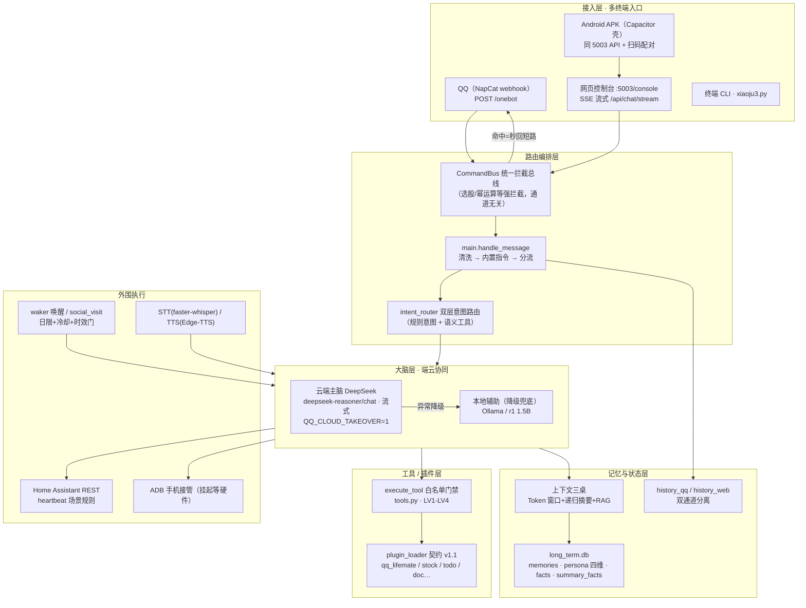
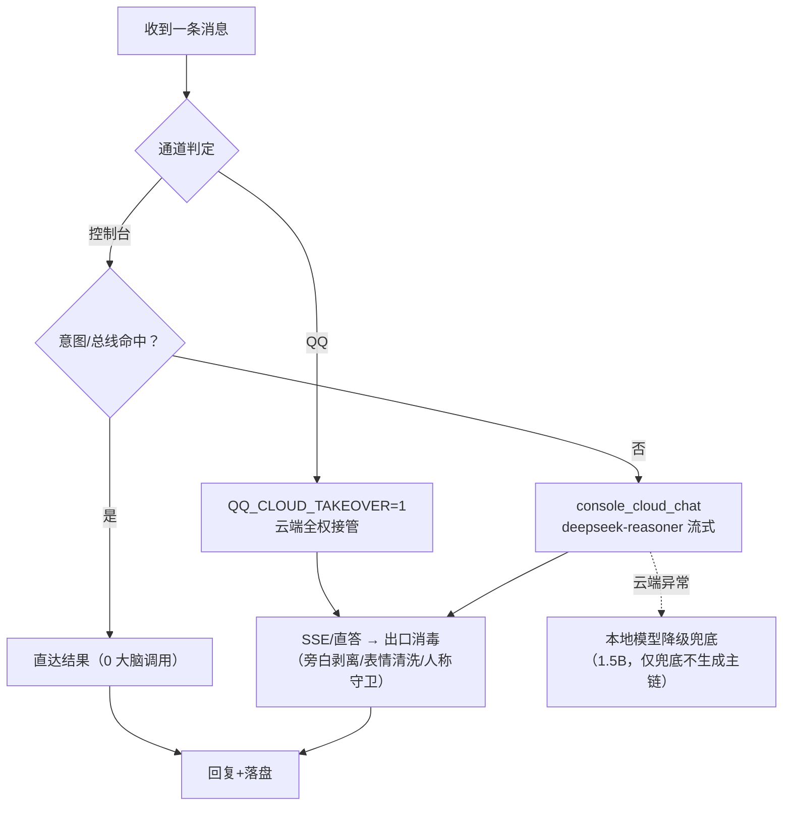

# 小橘3号（xiaoju3-agent）架构设计文档

| 项 | 内容 |
| --- | --- |
| 项目 | 小橘3号（xiaoju3-agent） |
| 文档名 | 架构设计文档 |
| 更新日期 | 2026-10-31（v2 审计版） |
| 版本基线 | 生产 v2.2.1 |
| 仓库 | https://github.com/Xun201/xiaoju3-agent |
| 开源协议 | MIT（产品口径，以仓库 LICENSE 为准） |

> **状态标记**：🟢 已实现（生产实证）｜🔶 部分/实验（在用但有限制或观察期）｜🔜 规划中
>
> **审计口径（如实说明）**：本版为 2026-10-31 **架构级审计刷新**——依据生产实证、交付战报（`_dev/SYNC_DEEPSEEK.md` 历史批次、`docs/dev_changelog_*.md`）与业界查证（见文末参考资料）重写架构口径；上一版（2026-09-29）的行号级引用已失效，本轮改以**模块名锚定**，逐行级源码重核列入后续维护项。

## 0. 2026-10-31 审计修订说明（相对 2026-09-29 版的重大变化）

| # | 变化 | 依据 |
| --- | --- | --- |
| 1 | **双脑决策方向反转**：本地 Ollama 优先 → **云端 DeepSeek 全权接管**，本地 1.5B 模型剥夺生成权（四连真机验收：狐狸腔/认领式记忆/无实体/开灯全过） | 2026-10-28 多脑重组验收 |
| 2 | 新增**统一指令分发总线**（CommandBus）与**双层意图路由**（intent_router） | 切片 a 落地 |
| 3 | 记忆体系升级为**上下文三桌**（Token 动态窗口 + 递归摘要 + RAG 兜底）+ 人格沉淀四维库 | 2026-10-28 批 |
| 4 | 新增**影子审查员**（TaskLedger+触发三则+FALSIFY，影子观察模式） | 2026-10-28 |
| 5 | 部署形态定型：**Windows onedir 三进程 + Inno 安装器 + Capacitor APK** | v2.2.1 Released |
| 6 | 多端架构拍板**方案 A 主从架构**（4060 主机=唯一真相源，APK 瘦客户端） | `_dev/design_multiplatform_roadmap.md` |
| 7 | 开发协作体系独立成章：**老板-秘书-包工头**三人协作 + DeepSeek MCP + 协作总线 | AGENTS.md 2026-10-27/30 立宪 |
| 8 | 安全线大幅扩容：Token 防刷、五项防身术、QQ 保命模式、发送回执校验、合规自查 | 2026-10-28/30 批 |
| 9 | ADB 手机接管线**挂起**（等硬件），定位收敛为"AI 伙伴/管家（非家庭控制中枢/非恋爱模拟）" | 2026-10-11 定位收敛 |
| 10 | 界面架构迭代：色块化布局、v0 皮肤、流式 SSE、协作面板；移动端独立三文档立项（见 `_dev/docs/design_mobile_*.md`） | 本轮 + d44b999 |
| 11 | **桌面全自动操控立项**（2026-10-31 队长拍板）：删除"不承诺全自动操控"绝对表述，改为分阶段演进口径；**同日二拍板**：单步确认不得作为独立产品阶段（反人类），并入阶段二作调试过渡——两段式：录制回放 → 沙箱内全自动执行；恋爱模拟条目保持现状不扩展 | 队长指令 + 演进路线草案 |

## 1. 设计目标与原则

小橘3号是"住在家用设备里"的私人 AI 管家：有自己的名字、性格与橘色狐狸娘形象，经 QQ、网页控制台、Android APK 与终端 CLI 对话，能陪聊、记事、管待办、控智能家居、做信息辅助（天气/炒股/文档）。**产品定位（2026-10-11 收敛，2026-10-31 修订）：AI 伙伴/管家——不是家庭控制中枢，不是恋爱模拟（陪伴向以现有插件程度为准，不再强化）；桌面全自动操控按分阶段演进推进：技能录制回放 → 沙箱内全自动执行（早期 HITL 确认仅为调试过渡，稳定后全自动=「豆包模式」）（路线草案见 `_dev/design_desktop_automation_roadmap.md`），不做无沙箱边界的自由操控承诺。**

| # | 原则 | 含义 | 现状 |
| --- | --- | --- | --- |
| 1 | 端云协同双脑 | 云端 DeepSeek 为主脑（质量/工具遵循/流式思考），本地小模型为降级兜底与辅助任务；路由对用户透明 | 🟢（多脑重组后云端接管，见 §3） |
| 2 | 数据不出家门 | 会话记忆、设备状态、密钥全部留在本地；上传仓库过隐私门禁 | 🟢（push.sh 四道扫描 + `_dev/` 整体出库） |
| 3 | 插件化 | 能力=独立插件/工具，加功能不改主程序；插件有装载契约与启停开关 | 🟢（plugin_loader 契约 v1.1） |
| 4 | 主从多端 | Windows 主机（4060）=唯一真相源与算力核心；APK/手机浏览器=瘦客户端；不做数据漫游分叉 | 🟢（方案 A，多端白皮书） |
| 5 | 安全分层与 HITL | 危险动作分级门禁（LV1-LV4 TOTP）+ 儿童锁人在环路 + 影子审查兜底 | 🟢 |

## 2. 总体架构

后端为 Flask 单体（`main.py` 承载 QQ 业务、`xiaoju3_dashboard.py` 承载 5003 控制台与 OneBot 入口、`xiaoju3.py` 终端 CLI），生产以 **onedir 冻结三进程**（main / launcher / dashboard）常驻。

**分层职责对照**：

| 层 | 主要代码 | 职责 | 现状 |
| --- | --- | --- | --- |
| 接入层 | xiaoju3_dashboard.py（5003 唯一 HTTP 入口）、main.py（QQ 业务体，宿主 5003 进程）、xiaoju3.py（CLI）、android_app/（APK 壳） | 收消息、鉴权、静态托管、CORS | 🟢 |
| 路由层 | CommandBus（main 内）、intent_router.py、main.handle_message | 通道无关强拦截 → 意图直达 → 兜底进大脑 | 🟢 |
| 大脑层 | brain.py（smart_ask / smart_ask_stream / console_cloud_chat） | 云端主脑流式（think+answer 双帧）、本地降级、工具 JSON 协议 | 🟢 |
| 工具/插件层 | tools.py、plugin_loader、agent_state/plugins/* | 白名单执行、高危门禁、插件装载/启停（持久化） | 🟢 |
| 记忆与状态层 | history_*.json、agent_state/state_manager.py、long_term.db、todos.db | 会话分离、长期记忆、人格沉淀、上下文三桌 | 🟢 |
| 外围执行 | home_tools.py、heartbeat.py、qq_lifemate/*、search_tools.py、天气/炒股插件 | 家居、唤醒、语音表情、联网搜索、信息插件 | 🟢 / ADB 🔶 挂起 |

**进程与部署角色**：

| 进程/产物 | 角色 |
| --- | --- |
| xiaoju3.exe（frozen onedir） | 生产三进程：main（QQ+总线）、launcher（桌面壳/监督）、dashboard（5003） |
| xiaoju3-x.y.z-setup.exe | Inno 安装器（CloseApplications+AppMutex 互斥体+卸载清理） |
| xiaoju3-phone APK | Capacitor 6.2.3 壳，真源=assets/public，扫码配对+探活自愈+诊断面板 |
| soul_export / soul_import | 灵魂备份迁移（MANIFEST 强校验）；PeerWatch 对端守望 🔶（不自动接管） |

## 3. 端云双脑决策（2026-10-28 多脑重组定稿）

要点：

1. **云端全权接管 🟢**：QQ 通道与控制台闲聊均直连云端（本地 1.5B 剥夺生成权）。理由（实测数据，`bench_multi_brain.py` 可复跑）：端云单次协同省 token 63% 但耗时负收益（本地 r1 提取 2.6s 吃掉收益）；本地小模型存在工具编造/语言漂移等"本地能力边界"死法实录。
2. **本地模型角色**：降级兜底（云端异常）+ STT（faster-whisper）等非生成任务。多脑提取架构保留为长上下文（8k+）预备队 🔜。
3. **路由三入口**：①CommandBus 强拦截（选股/幂运算等，通道无关、秒回）②intent_router 双层路由（规则意图直达+语义工具调用）③兜底进大脑。端云智能路由分流（复杂度裁判）已入库 #362（P1）🔜——业界同构方案为 RouteLLM / cascade routing（见参考资料 [6][7]）。
4. **工具协议**：模型按提示词输出一行 JSON → 白名单校验 → execute_tool → 结果喂回生成自然语言回答；无 function calling 原生依赖。
5. **出口消毒链 🟢**：动作旁白剥离（有界词表防误伤）→ 表情占位全角变体提取与 TTS 清洗（express.clean_for_tts 单一出口）→ 人称守卫/能力宣称守卫（虚假完成四形态四守卫）。

## 4. 记忆与上下文管理（上下文三桌）

| 能力 | 实现 | 现状 |
| --- | --- | --- |
| 双通道分离 | QQ 与网页会话分文件保存 | 🟢 |
| Token 动态窗口 | estimate_tokens 启发式（CJK≈1/字），窗口 cloud=32000 / local=4096，70% 触发压缩，条数硬帽 120 保险丝 | 🟢 |
| 递归摘要 | 旧【前情提要】并入再浓缩，单份不增殖 | 🟢 |
| RAG 兜底（第三层） | compress 成功后提取主人偏好/计划/约定（第三人称 KEY=VALUE ≤5 条）落 long_term.db summary_facts，召回时可检索找回；降级路径零沉淀防污染 | 🟢 |
| 长期记忆 | long_term.db（SQLite）memories 表；"记住"链 save_memory UPDATE 优先去重；记忆面板（list+删除） | 🟢 |
| 人格沉淀四维 | tags/traits/strategies/taboos → persona_profile，回答前注入【你对她本能的认知】；每维 cap 5 条 | 🟢 |
| 关系化人格 #271 | rel_mode 表+五模式判定+事件触发节流+三段注入（开关控制） | 🟢 |
| 记忆人称铁律 | 主人第一人称→第三人称转换（to_third_person_memory）+ 提示词双条款，落库口全覆盖 | 🟢 |
| 主动记忆注入 | recall 三乘子 + Hindsight 式反思合成 🔜（借鉴项已侦察，见 `_dev/recon_ai_companion_ecosystem.md`） | 🔜 |

## 5. 插件系统与意图路由

- **装载契约 v1.1 🟢**：plugin_loader 工厂函数 PLUGIN()；禁用集持久化（plugins_enabled.json）；启停 API（/api/plugins/toggle）+ 控制台管理面板；teardown 钩子卸载后台线程。
- **动态引用纪律 🟢**：字符串动态引用的插件模块必须同步补 xiaoju3.spec hiddenimports（先例：accounting/ebook_export/todo_text）——冻结包 ModuleNotFoundError 静默吞噬的教训已入 AGENTS.md。
- **插件清单（生产在用）**：

| 插件 | 职责 |
| --- | --- |
| qq_lifemate | 唤醒（waker）+ 语音/表情（express）+ 记忆事实 + 每日回放 + 社交串门 |
| stock_assistant | 三层选股流水线 + DeepSeek 政策面 + 合规声明（QQ 通道强拦截屏蔽） |
| todo_text / accounting / ebook_export | 待办、记账、电子书导出 |
| video_ingest / doc_ingest | 视频转写（faster-whisper）、文档入库（切片+向量） |
| context_manager / summary_facts | 上下文压缩、RAG 兜底 |
| help_menu / link_logger / batch_logger | 帮助菜单、链接抓取、长文分片总结 |

- **CommandBus 🟢**：main 内统一拦截总线（register/dispatch），拦截器异常自动放行原链路；QQ/控制台一次注册全端生效；总线任务=异步秒回+后台执行+结果推送。

## 6. 权限体系与 HITL（人在环路）

- **四级权限 🟢**（TOTP 校验，等级落盘 identity.json）：LV1 路人（聊天/搜索/读文件）→ LV2（写文件，/register）→ LV3（代码/插件/安全家居六类 domain，/coder_auth）→ LV4（危险设备 lock/valve/阀、ADB、发图、restart_service，/lv4_auth confirm）。
- **物理安全底线 ⚠️**：危险设备保留独立物理机械开关，软件权限任何等级都不高于物理开关。
- **儿童锁 HITL 🟢**：开启后，被登记为儿童的用户执行危险家电操作 → QQ 推送 🔒 请求 → 在线成人 LV4 回复 /approve 或 /deny（对齐业界 HITL"批准/拒绝"卡片共识，见参考资料 [10]）。
- **影子审查员 🔶**：TaskLedger 会话账本+触发三则（T1 重复/T2 跳族/T3 败后续）+ FALSIFY 证伪条件；影子模式只观察不拦截（开关缺省开），观察期后判读误报率再拍板真拦截。
- **操作级双因子已取消（2026-10-02）**：LV4 授权后危险操作不再逐次验证；生物认证（Windows Hello 真因子）列为远期 #258。

## 7. 主动服务与唤醒

| 环节 | 实现 | 现状 |
| --- | --- | --- |
| 心跳 | 60s 轮询 HA 八类实体；快照无变化跳过（0 token）；场景规则（回家开灯/湿度加湿器）命中直执行 | 🟢 |
| 唤醒（waker） | 10 分钟检查；静默 4h+quiet 23:00-08:00+日限 5；张力双轨（≥0.6 静默阈值减半）；2h mtime 时效门；回放过去式体+只寒暄不补作业死命令 | 🟢 |
| 社交串门 | social_visit 社交池随机选好友；24h 冷却+日限 3+3-6s 拟人延迟+fail-closed | 🟢（观察期） |
| 主动打扰边界 | **业界共识=主动推送必须"用户显式预约+分级静默"，无预约主动打扰是反模式**（参考资料 [12][13]）——waker 全部参数有硬上限+可关，与该共识一致；Ntfy 分级推送（#370）按此原则设计 🔜 | 🟢/🔜 |

## 8. 部署架构

- **Windows 生产 🟢**：onedir 冻结三进程 + Inno 安装器（v2.2.1）；自动自启（HKCU Run 双通道）；桌面互斥体防多开；升级走 rename 绕锁保留 .old。
- **APK 🟢**：Capacitor 6.2.3 本地构建链（国内镜像全自动）；扫码配对（LAN+Tailscale 双 IP 编码）；探活自愈（probeBase 探当前 base、换址才重载）；错误红条上屏诊断。
- **主从多端（方案 A，已拍板 🟢）**：4060 主机=唯一真相源（agent_state+history+db 全在主机）；APK/手机浏览器=纯瘦客户端直连 5003 API+SSE。**SQLite 漫游/数据分叉方案永久冻结**（灵魂分叉灾难），重评条件见多端白皮书。
- **Linux 🔜（仅评估记账）**：Docker 后端+浏览器（改造最小）或 PyInstaller ELF（须换 WebView 后端链）；ARM/龙芯 wheel 为硬风险。麒麟/深度=浏览器直连 Windows 主机的零成本方案（`docs/SYSTEM_SUPPORT.md`）。
- ** souls 迁移 🟢**：/soul_export //soul_import（MANIFEST 强校验）；PeerWatch 对端守望（不自动接管）。

## 9. 安全与隐私

**已实现 🟢**：工作区沙箱（realpath 前缀校验）｜读取限幅｜LV 门禁｜push.sh 四道隐私扫描｜密钥全部 .env 隔离区｜启动哈希校验｜`_dev/` 整体退出 git 历史（filter-repo）｜git add -A 永久禁用｜Token 防刷（幂运算 M>100/N>10^9 拒算）｜五项防身术（45s 看门狗/越权红线/日志轮转/推送不进历史/疑问豁免）｜QQ 保命模式（日限 40+间隔 3-6s+选股屏蔽，NapCat token 认证+发送回执校验）｜前端 XSS 转义+textContent 渲染。

**业界教训吸收**（参考资料 [8][9]）：桌面 Agent"本地全权执行"必须配权限最小化、命令审批与分发防仿冒——对应本项目的 LV 门禁+儿童锁 HITL+安装器签名意识；升级为非对称签名 Recovery Mode 列远期 🔜（#327 系）。

**已知风险（如实）**：/onebot 依赖内网+token 认证（NapCat 侧）；影子审查仍在观察期；APK 明文 HTTP（Tailscale CGNAT 段约束，闭环局域网/虚拟局域网使用定位）。

## 10. 协议与生态演进（MCP / A2A / Computer Use）

| 项 | 业界现状（2026-10 查证） | 小橘口径 |
| --- | --- | --- |
| MCP | Anthropic 2024-11 发布 → OpenAI/Google 采纳 → 2025-12 捐 Linux Foundation（AAIF），工具连接层**事实标准**（参考资料 [4][5]） | 现状：自有 JSON 工具协议+白名单（内网单用户场景够用）；演进：工具层 MCP server 化列为二期方向 🔜（对外能力开放时再立项） |
| A2A | Google 2025-04 发布、捐 Linux Foundation，150+ 组织（企业级为主）（参考资料 [11]） | 单机双脑暂无必要，不作规划 |
| Computer Use | 自由形态仍演示/实验级：Anthropic 仍 beta、OpenAI Operator 并入 ChatGPT agent、Mariner 已停、OSWorld 长程任务完成率 20-55%（参考资料 [14][15][16]）——正因如此，业界成熟路径是**录制回放起步、单步确认、沙箱内自动**（豆包电脑版虚拟桌面/微软 Agent Workspace 同构） | **分阶段演进**（2026-10-31 队长拍板）：技能录制回放 → 沙箱内全自动执行（早期 HITL 确认仅为调试过渡，稳定后全自动=「豆包模式」）；不做无沙箱自由操控；路线草案 `_dev/design_desktop_automation_roadmap.md` |
| Agent 分层参照 | 学界四模块（Profiling/Memory/Planning/Action）+ Anthropic"workflows 优先、克制 agent 化"（参考资料 [1][2][3]） | 小橘日常任务走固定链路（意图/总线/场景规则），仅复杂任务进 agent loop——与业界主张同构 |

## 11. 规划路线图（2026-10-31 刷新）

| 方向 | 内容 | 状态 |
| --- | --- | --- |
| 移动端 | mobile.html 三文档驱动重构（本轮，等拍板） | 🔜 立项 |
| 路由 | 端云智能路由分流（复杂度裁判，#362 P1，参考 RouteLLM） | 🔜 |
| 推送 | Ntfy 分级推送（critical/静默两档，#370） | 🔜 |
| 移动二期 | 相册发图（#369）、离线状态漫游（#371，受方案 A 约束重评） | 🔜 |
| 记忆 | 反思合成（reflection）/时序失效边（memory V3）——业界侦察已入档 | 🔜 |
| 安全 | Windows Hello 真二因子（#258）；非对称签名 Recovery Mode | 🔜 远期 |
| 生态 | 工具层 MCP server 化（对外开放时立项） | 🔜 远期 |
| 拟真进阶 | 自我反思/画像/情感计算/事件引擎/任务调度/多智能体——保留储备，按需启动 | 🔜 |
| 桌面操控 | 分阶段演进立项（阶段一=技能录制回放，阶段二=沙箱内全自动执行；早期 HITL 确认为调试过渡不作产品阶段——2026-10-31 队长二拍板；DA1 已动工） | 🔜 DA1 开发中 |
| 挂起 | ADB 手机接管（等硬件）；Linux 原生（等需求） | 🔜 冻结 |

---

## 【参考资料】（2026-10-30/31 查证，铁律二扩展条款）

1. Wang et al., *A Survey on Large Language Model based Autonomous Agents*（四模块：Profiling/Memory/Planning/Action）：https://arxiv.org/abs/2308.11432
2. Anthropic, *Building Effective Agents*（workflows vs agents；从简单组合起步）：https://www.anthropic.com/engineering/building-effective-agents
3. OpenAI, *A practical guide to building agents*（2025-06，34 页）：https://cdn.openai.com/business-guides-and-resources/a-practical-guide-to-building-agents.pdf
4. Anthropic, *Model Context Protocol* 发布公告：https://www.anthropic.com/news/model-context-protocol ；MCP 官方文档：https://modelcontextprotocol.io
5. MCP 采纳与治理（OpenAI 2025-03 采纳、注册表规模、Linux Foundation/AAIF 2025-12）：https://www.digitalapplied.com/blog/mcp-adoption-statistics-2026-model-context-protocol
6. RouteLLM（LMSYS，简单请求走弱模型省 ~85% 成本）：https://www.lmsys.org/blog/2024-07-01-routellm
7. *Cascade Routing* 综述（model routing / LLM cascades 统一口径）：https://arxiv.org/abs/2410.10347
8. OpenClaw（原 Clawdbot）架构与安全教训（单进程本地 Gateway+channels 插件；仿冒站点供应链攻击）：https://docs.openclaw.ai/concepts/architecture
9. Windows, *Securing AI Agents on Windows*（OS 级沙箱与实验模式）：https://blogs.windows.com/windowsexperience/2025/10/16/securing-ai-agents-on-windows
10. OpenAI Agents SDK, *Human-in-the-loop*（needs_approval 暂停-批准/拒绝模式）：https://openai.github.io/openai-agents-python/human_in_the_loop
11. Google Cloud, *Agent2Agent Protocol*（发布与 Linux Foundation 捐赠）：https://developers.googleblog.com/en/a2a-a-new-era-of-agent-interoperability ；https://www.linuxfoundation.org/press/a2a-protocol-surpasses-150-organizations-lands-in-major-cloud-platforms-and-sees-enterprise-production-use-in-first-year
12. OpenAI Help, *Scheduled tasks in ChatGPT*（显式预约的定时任务）：https://help.openai.com/en/articles/10291617-scheduled-tasks-in-chatgpt
13. ntfy（self-hosted 推送，按主题/严重度分级）：https://ntfy.sh
14. The Verge（Anthropic Computer Use "cumbersome and error-prone" 实测报道，2024-11）
15. OpenAI, *Introducing ChatGPT agent*（Operator 并入）：https://openai.com/index/introducing-chatgpt-agent
16. OSWorld 基准（人类基线 72.36% vs 2024 agent ~12%；长程任务 2025 仍 20-55%）：https://os-world.github.io
17. Home Assistant, *Voice chapter 11*（HA Assist 多语言+LLM 控制）：https://www.home-assistant.io/blog/2025/10/22/voice-chapter-11
18. 项目内部依据：`_dev/SYNC_DEEPSEEK.md`（历史批次战报）、`_dev/design_multiplatform_roadmap.md`、`docs/dev_changelog_*.md`、`_dev/bench_multi_brain.py`
19. 桌面操控演进路线草案（含豆包工作/UI-TARS/OmniParser/微软 Agent 安全白皮书等全部来源）：`_dev/design_desktop_automation_roadmap.md`
